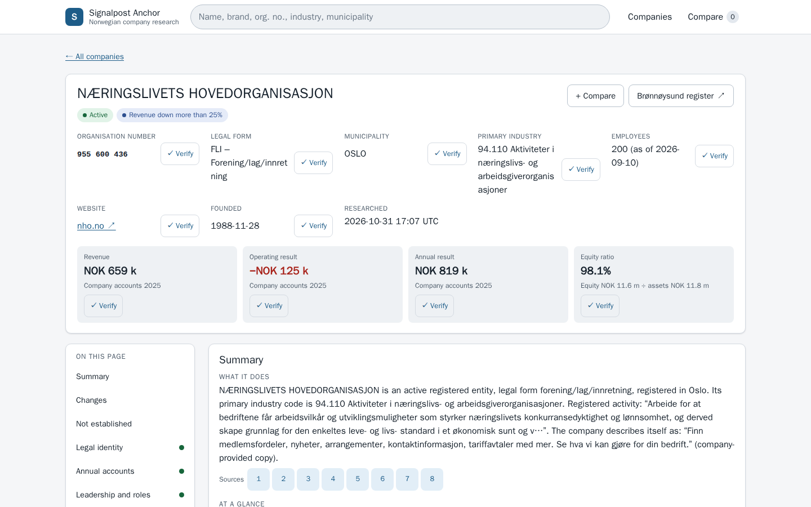
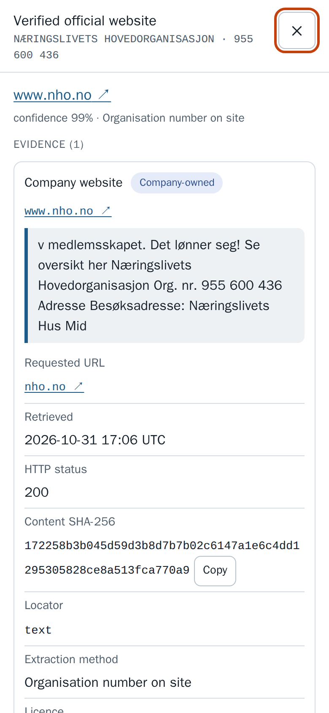

# Signalpost Anchor

A research agent for Norwegian companies. Give it organisation numbers; it returns one terminal envelope per company with atomic, dated facts, each tied to a source URL, retrieval time, content hash, locator and the exact excerpt it was read from, plus explicit unknowns, a sourced synthesis, refresh diffs and a static site to find, compare and verify the results.

Every fact is anchored on the organisation number: either it comes from a source keyed by that number (Brønnøysundregistrene, NAV employer number, Wikidata P2333, GLEIF registeredAs), or it comes from a website that was tied back to that number before anything was extracted from it. When the link cannot be proven, nothing is published and the section says `ambiguous` or `not_available`.

AI-assisted, human-directed.

## Run

Python 3.10+ (tested on 3.12), no API keys, no paid services.

```bash
python3 -m venv .venv && . .venv/bin/activate && pip install -r requirements.txt
python -m signalpost_anchor run --input companies.jsonl --output out
```

One-line form for the evaluator (clean machine, from the repository root):

```bash
python3 -m venv .venv && .venv/bin/pip install -r requirements.txt && .venv/bin/python -m signalpost_anchor run --input <BATCH_FILE> --output <OUTPUT_DIR>
```

`--input` accepts JSONL (`{"organisation_number": "..."}` per line; `orgnr`, `organisasjonsnummer`, `org` and bare strings also work), JSON (a list or `{"organisation_numbers": [...]}`), CSV with an `organisation_number` column, or plain text. Input and output can also be given as `SIGNALPOST_INPUT` / `SIGNALPOST_OUTPUT`.

Outputs in `<OUTPUT_DIR>`:

| Path | Content |
|---|---|
| `envelopes.jsonl` | exactly one terminal envelope per unique input number, in input order (schema: [docs/DATA_SCHEMA.md](docs/DATA_SCHEMA.md)) |
| `run-report.json` | validation (exact count, unique, terminal states, evidence completeness), coverage per field family, claim counts, request count, bytes, p50/p95 runtime per company, cost, source health |
| `site/index.html` | static site: search, filters, company profiles, evidence "Verify" panels, side-by-side compare; works on desktop and mobile and from `file://` |
| `snapshots/` | content-addressed raw source documents (gzip) referenced by `source_snapshots` |
| `history/` | previous `envelopes.jsonl` files archived on refresh; together with each envelope's `history` and change records this keeps the previous run's evidence |
| `withheld.jsonl` | items that were found but not published, one per line with the rule that withheld them, the page URL and the content hash of the cached page (for example a footer link to the web agency's Facebook page, a news menu label, a careers landing page); counts per rule are in `run-report.json` under `withheld` |

Run the same command again on the same output directory (or pass `--previous <earlier envelopes.jsonl>`) to refresh: changes are reported per claim, unchanged sources produce no changes, failed sources keep the last supported value marked stale, and every envelope gets a `whats_new` list (what is new since the previous run and why it matters, plus the latest movements in this run's evidence) that the site shows on each profile and summarises on the run page ([docs/REFRESH.md](docs/REFRESH.md)).

### Budget controls

| Option / environment variable | Default | Meaning |
|---|---|---|
| `--time-budget` / `SIGNALPOST_TIME_BUDGET_SECONDS` | 1800 | wall-clock budget for the whole run; the agent stops research early enough to always write every envelope |
| `--company-budget` / `SIGNALPOST_COMPANY_BUDGET_SECONDS` | 75 | per-company research budget |
| `--concurrency` / `SIGNALPOST_CONCURRENCY` | 24 | companies researched in parallel |
| `--filing-budget` / `SIGNALPOST_FILING_BUDGET_SECONDS` | 900 | time the provider-rate-limited filed-copy lookup may use |
| `--nav-lookback-days` | 180 | window of the NAV job feed that is indexed |
| `--no-web`, `--no-guess`, `--no-jobs`, `--no-external`, `--no-filing-years`, `--no-site`, `--no-snapshots` | off | disable a source or output |

A company that runs out of budget still gets its envelope; unfinished sections are `failed` with the reason.

## What it finds

| Section | Facts | Source |
|---|---|---|
| Legal identity and brand | legal name, form, status (active, bankrupt, liquidating, forced dissolution, deleted), registration/founding dates, VAT registration (including voluntary VAT and its basis), membership of Foretaks-, Stiftelses-, Frivillighets- and Partiregisteret, registry annotations, NACE codes, sector, auxiliary unit code, employees (Aa-registeret, dated), statutory purpose and activity, share capital, former names, parent unit; public brand and stated founding year from the verified website | Enhetsregisteret, company website |
| Annual accounts | up to three years of company and group accounts: revenue, operating result, profit before tax, result, assets, equity, liabilities and ~20 more lines, audit status, accounting rules; years with an official filed copy | Regnskapsregisteret |
| Leadership | CEO, chair, board, deputies, auditor, accountant, owner and other roles (names only) with last-changed dates; which of these role holders the verified website names | Enhetsregisteret roles, company website |
| Workplaces | registered subunits with address, industry, employees and start date; business address; the registered address where the website shows it, addresses and opening hours in the website's structured data; LEI legal and headquarters addresses | Enhetsregisteret, company website, GLEIF |
| Website | verified official site with the method that proved it and whether the site is the company's own or shared with other organisations, description, about-page description, products and services from structured data, title, language, logo; a registered parent's site is labelled as the parent's, and a group, chain, brand or manager site that names the company by its organisation number or exact legal name is labelled as such, never published as the company's own | registry, Wikidata, NAV, email domain, domains derived from the legal, subunit and former names |
| Company-owned profiles | LinkedIn, Facebook, Instagram, YouTube, X, TikTok and others linked from the verified site whose handle or profile name matches the company's legal, former, subunit or brand name (agency, theme, site-builder and parent accounts are dropped; on an international group's site the handle must name the legal name or carry a Norwegian marker, and handles of a foreign parent or sibling are dropped), or recorded on Wikidata | company website, Wikidata |
| Hiring | single active NAV job ads whose employer organisation number is the company or one of its subunits (always the ad's own page); JSON-LD job postings on the verified site whose hiring organisation is the company. Careers landing pages and recruitment-portal links are not published as jobs | NAV job vacancy feed, company website |
| Dated public activity | registry change events (name, address, industry, capital, filings, headcount reports, status), role-group updates, news articles from the company's own site: a distinct post URL, a real title, a publish date (never a modified, feed-updated or sitemap date) and an article page that was opened and reads like a story (no product, offer, catalogue, sale, campaign, price-list or testimonial page, at least 30 words of running text) | Enhetsregisteret update feed, company website |
| Contact | registered email/phone/postal address; role mailboxes and phone numbers on the verified site (links, labelled numbers in the text, structured data) | Enhetsregisteret, company website |
| External identifiers | Brønnøysund page, LEI with status and first-issued date, Wikidata item, Wikipedia articles, ISIN | GLEIF, Wikidata |

The synthesis explains what the company does, its size and latest filed numbers with year-on-year movement, leadership, public footprint, what changed (registry events and, on a refresh, what is new since the previous run) and what remains unknown. Each paragraph lists the claim ids it rests on. It is generated deterministically from published claims; no language model is used.

How identities are proven: [docs/IDENTITY_RESOLUTION.md](docs/IDENTITY_RESOLUTION.md). Sources, rights, rate limits and URL safety: [docs/SOURCES.md](docs/SOURCES.md). Known gaps: [docs/LIMITATIONS.md](docs/LIMITATIONS.md).

## Models, APIs, licences, cost

| Item | Detail |
|---|---|
| Models | none |
| APIs | Brønnøysundregistrene Enhetsregisteret and Regnskapsregisteret open APIs (NLOD 2.0); NAV job vacancy feed (NAV API terms; public token fetched at run time, optional `NAV_FEED_TOKEN`); Wikidata Query Service (CC0); GLEIF LEI API (CC0); company websites (robots.txt respected) |
| Python dependencies | httpx (BSD-3-Clause), beautifulsoup4 (MIT), lxml (BSD-3-Clause) and their pinned transitive dependencies in `requirements.txt` |
| Secrets | none required |
| Third-party cost per official run | USD 0 |
| Code licence | MIT |

## 100-company smoke test

Run from a clean clone at commit `e89dca9` in a fresh `python:3.12-slim` container (2 CPUs, 2 GB, unprivileged user, on a server shared with other jobs), only `pip install -r requirements.txt` before the run command:

| Result | Value |
|---|---|
| Envelopes | 100 / 100, all terminal, validation passed |
| Claims | 12,030 (120 per company), every one with source URL, retrieval time, SHA-256, locator and excerpt |
| Companies with accounts / roles / workplaces / registry activity | 96 / 96 / 90 / 97 |
| Verified official website | 31 (14 by organisation number on the site) |
| Company-owned profiles / contact details / LEI | 16 / 69 / 13 |
| Single job ads / dated website articles | 2 / 5 |
| Items found but withheld by a publication rule | 134 (`reports/smoke-withheld.jsonl`) |
| Wall-clock runtime | 98 s (p50 3.7 s, p95 23.0 s per company) |
| Requests | 1,492 |
| Third-party cost / model calls | USD 0 / 0 |
| Refresh re-run on a copy of the output | 0 change records (idempotent), 98 s |
| Refresh against 1.3.0's envelopes of the day before | nothing new at the source; 1 item that a stricter rule now withholds, reported as such (`reports/smoke-since-1.3.0-run-report.json`) |
| Test suite in the same kind of clean container | 104 passed |

Full report with the per-company table: [reports/SMOKE_TEST.md](reports/SMOKE_TEST.md); machine-readable reports: `reports/smoke-run-report.json`, `reports/smoke-refresh-run-report.json`; the envelopes themselves: `reports/smoke-envelopes.jsonl.gz`.

A 1,000-company random sample from the public universe (`reports/sample-1000-companies.jsonl`) completed in 358 s with 1,000/1,000 envelopes and 104,895 claims from the same clean clone; report: `reports/sample-1000-run-report.json`. Builderr's published sample of 100 companies: `reports/builderr-sample-100-run-report.json`.

### The static site

`site/index.html` in every output directory opens from the file system on desktop and mobile, with no server or network. The run summary and `run-report.json` (`site.index`) give its path. On a refresh, each profile's "What changed since the last run" panel lists what is new with a "why it matters" line and a Verify button, then the latest movements in the evidence; the run page says how many companies have something new and links to them. Screenshots from the 1.3.0 smoke run (the layout is the same in 1.4.0):

| Desktop | Mobile |
|---|---|
|  |  |

More: [list](docs/screenshots/desktop-list.png), [evidence panel](docs/screenshots/desktop-verify.png), [side-by-side compare](docs/screenshots/desktop-compare.png), [mobile list](docs/screenshots/mobile-list.png), [mobile profile](docs/screenshots/mobile-profile.png).

### Revision 4 (1.4.0) against revision 3 (1.3.0, `2e5f32a`)

Builderr's review of revision 3 (1 November) found news items that were product or sale pages ("Showroom Salg"), a LinkedIn page of a Swedish group published for a Norwegian company, and a parked appelx.com chosen over the company's appelx.no, and asked for a human hand-check per source type and a "what changed since the last run" view. 1.4.0 answers each point:

- **News must read like an article.** A dated candidate is published only after its own page has been opened and checked: no Product, Offer or vehicle markup and no `og:type` product, not in a catalogue, shop or sale section (`/products/`, `/vare-hytter/`, `/tilbud/`, `/showroom-…`), not filed under a product, sale or testimonial category in the site's feed (`Produkter`, `Våre hytter`, `Sitater`), no sale or campaign title ("Showroom Salg", "Black Friday", "30 % rabatt"), not a price list (three or more prices with under 30 words of text per price), not template filler, and at least 30 words of running text read from the article body (menus, footers, cookie banners and link lists do not count); it also needs an article signal (Article markup, `og:type` article, a news path or date in the URL, the site's own feed, or a publish date on the page). The 15 most recent candidates per site are checked. Each published item cites both the feed or listing entry that gave its date and the article page, with the check (`article_check`). The "Showroom Salg" item from Builderr's run is not in any of our samples (we searched every 1.3.0 envelope, withheld item and cached page), so its regression test uses a page rebuilt from the description; the other tests use real pages from our runs: idehytta.no's cabin model "Knatvold" from its feed (published by 1.3.0), a one-line photo post, a three-sentence contract story that must stay, and an article whose text sits outside the page's `<main>`.
- **Social pages of a foreign group.** The LinkedIn case is PEAB BYGG AS: its registry-listed site peab.no/bygg links `linkedin.com/company/peab` and `youtube.com/user/peab`, the accounts of the Swedish Peab group. When the verified site belongs to an international group (it links the same brand's sites abroad, `peab.se`, `peab.fi`, `peab.dk`; names a foreign company of the brand, `<brand> AB / ApS / Oy / GmbH / Sverige / Danmark`; or declares the bare brand as its legal entity, `"legalName": "Peab AS"`), a social account is published only when its handle names the company's legal name (`peab-bygg-as`), carries a Norwegian marker (`peabnorge`), or its link text names the company or its organisation number. Handles with a foreign country or legal-form marker that is not part of the company's own name (`filippa-k-sverige`, `filippakab`) are withheld everywhere; a Norwegian branch of a foreign company (NUF) is exempt because the foreign company is the company. The platforms are still never fetched, so the handle, the link text and the verified site are the evidence.
- **Parked domains.** APPELX AS lists `www.appelx.no` in Brønnøysund and `post@appelx.com` as its email. appelx.com is a parking lander (a script that redirects to `/lander` and nothing else); 1.3.0 accepted it because the email domain spells the name. 1.4.0 never verifies a parking lander, a for-sale or "make an offer" page, a redirect to a domain marketplace or parking host (Sedo, Dan, Afternic, HugeDomains, Bodis, …), and an empty home page can no longer verify a domain by its name alone (a bot-protection challenge is not treated as parked). A domain that is verified only because it spells the name now waits until the other candidates are tried, so a candidate that proves the company on its pages wins. Today `www.appelx.no` redirects to studiox.no, the site of STUDIO X AS (920 990 029) at the same address, which does not mention Appelx; under the rule that a website must show the company's own number, name or contact details, 1.4.0 publishes no own website for APPELX AS and keeps `www.appelx.no` as the registry-listed address (`website.registry_listed`).
- **What changed since the last run.** Every envelope now has `whats_new`: what is new since the previous run and why it matters (new article, article found late, newly filed accounts year with its revenue change, restated figure, website gained, lost or moved to another domain, social account gained or removed, job ad posted or closed, status, name, CEO, chair, owner, auditor, address or headcount change), the latest movements in this run's own evidence (revenue between the two latest filed years, a result that changed sign, articles of the last 60 days, job ads of the last 30 days, registry changes of the last 90 days), and the items a stricter rule now withholds, kept apart so they are not reported as changes at the source. The previous run's evidence is kept (`history/`, change records with the previous evidence). The site shows this on every profile ("What changed since the last run": new items with "why it matters" and a Verify button, then latest movements) and on the run page; `run-report.json` counts it under `whats_new`; the synthesis lists the new items.
- **Hand-check.** `tools/handcheck_sheet.py` builds a sheet of every link the agent published for a stratified set of companies (website, social, news, jobs, registry and external profiles, website contacts) with empty right / wrong / unsure columns, and `tools/handcheck_counts.py` turns the filled sheet into counts per source type.

Measured in two ways, as for revision 3. Replay: 1.4.0 (`ea318cb`) ran live on 2026-11-01 with every HTTP response recorded, then 1.3.0 (`c431d48`) and 1.4.0 ran against the same recordings, so the differences come from the rules alone (1.3.0 asked for a few pages 1.4.0 never fetched, 8, 18, 136 and 4 requests on the four batches, so its side is slightly undercounted; `e89dca9` differs from `ea318cb` only in the what-changed labels). Live: the clean-clone runs of `e89dca9` above (2 CPUs, 2 GB) against 1.3.0's clean-clone runs of 31 October (6 CPUs, 6 GB) and, for Builderr's sample, 1.3.0's recorded run of 31 October. Companies / facts:

| Field family | Smoke 100, replay | Smoke 100, live | Random 100, replay | Random 100, live | 1,000, replay | 1,000, live | Builderr 100, replay | Builderr 100, live |
|---|---|---|---|---|---|---|---|---|
| Verified website (company's own) | 31 → 31 | 31 → 31 | 13 → 13 | 13 → 13 | 110 → 110 | 110 → 111 | 78 → 78 | 78 → 78 |
| Company-owned profiles | 16 / 34 → 16 / 34 | 16 / 34 → 16 / 34 | 7 / 10 → 7 / 10 | 7 / 10 → 7 / 10 | 63 / 119 → 63 / 119 | 63 / 119 → 64 / 120 | 38 / 82 → 38 / 80 | 38 / 82 → 38 / 80 |
| Website news | 6 / 38 → 5 / 37 | 6 / 38 → 5 / 37 | 1 / 1 → 1 / 1 | 1 / 1 → 1 / 1 | 19 / 113 → 18 / 105 | 19 / 113 → 18 / 105 | 18 / 129 → 17 / 95 | 18 / 129 → 17 / 95 |
| Job ads | 2 / 2 → 2 / 2 | 2 / 2 → 2 / 2 | 0 → 0 | 0 → 0 | 4 / 8 → 4 / 8 | 4 / 8 → 4 / 8 | 1 / 1 → 1 / 1 | 2 / 3 → 1 / 1 |
| Contact read from the website | 24 / 57 → 24 / 57 | 24 / 57 → 24 / 57 | 11 / 19 → 11 / 19 | 11 / 19 → 11 / 19 | 86 / 180 → 86 / 180 | 86 / 180 → 86 / 180 | 63 / 137 → 63 / 137 | 63 / 137 → 63 / 137 |
| Claims, all families | 11,883 → 11,898 | 12,107 → 12,030 | 10,622 → 10,622 | 10,839 → 10,831 | 103,716 → 103,806 | 104,856 → 104,895 | 14,659 → 14,653 | 14,970 → 15,010 |
| Wall-clock runtime | | 110 s → 98 s | | 117 s → 116 s | | 348 s → 358 s | | |

The live differences that the rules do not explain: levia.no (LEVIA AS) answered HTTP 429 on 31 October and was verified today, with its Instagram account; two NAV ads in Builderr's sample closed between the runs.

**News, checked item by item** (against the cached article pages of the replay; the check was AI-assisted, not the human hand-check). 1.3.0 published 281 dated items on the four batches; 1.4.0 keeps 238 and withholds 43:

| Withheld item | Items | Examples |
|---|---|---|
| Not an article: product, catalogue, testimonial or template page, event poster, specification sheet, list of PDF links | 16 | idehytta.no cabin model "Knatvold"; four "Produkter" posts of a mobility-aid shop; four customer quotes filed as "Sitater"; a vessel data sheet ("MAIN DATA Model: HSC21M Comfort"); concert posters; two report pages that only list PDF downloads; a "Lorem ipsum" press page |
| Genuine dated post with too little text to read as a story | 26 | 14 one-line photo posts of a children's technology club ("Spiller Nintendo på kveldsklubben."), 11 short school notices and greetings ("GOD SOMMER!", "Ledige skoleplasser …", 0–27 words), a two-sentence "new website" post |
| Real article lost | 1 | a blog post written as a poem (lines without sentence punctuation, so no running text is counted) |

That is the recall cost: 27 genuine posts (26 very short ones and one real article), on 3 of the 44 companies with news; no company lost all its news except three whose only item was not an article (the cabin model page, the vessel data sheet and the lorem-ipsum page). Of the 238 kept items, 218 read as articles or dated posts; 20 are product or service promotions written as blog posts without product markup (a coffee roaster's "Månedens kaffe", two new motorcycle models at a dealer, product presentations of a mobility-aid shop, three rental-pump service posts, two smoke-alarm articles, one webinar page); they pass the rule and are the borderline cases. No product, offer, sale or category page was among the kept items.

**Social pages.** 1.4.0 withholds two links on the four batches, both PEAB BYGG AS's (`linkedin.com/company/peab`, `youtube.com/user/peab`); both are the international Peab group's accounts, and `facebook.com/peabnorge` and `instagram.com/peabnorge` stay. Twelve verified sites are recognised as international group sites (AF Gruppen, Kitron, Consto, Nordic Door, Boomr, BudoXperten, Mazeppa Norge, Sentia, Ischebeck Nordic, Peab Bygg and the two Norwegian branches Mansoft and Elinar); their other accounts name the legal name, carry a Norwegian marker or belong to a NUF, and stay published. No right page was lost.

**Parked domains.** No published website changed on the four batches: 1.3.0 had published no parked page there. The new checks reject candidates that were not published anyway (on the 1,000 sample 60 parking-lander pages and 18 marketplace redirects among the name-derived guesses). APPELX AS, outside our samples, was run live with both versions: 1.3.0 publishes `https://appelx.com/` (domain spells the name), 1.4.0 rejects it as a parking lander and publishes no own website (see above).

**What changed since the last run, on real data.** Against 1.3.0's envelopes of the day before (a weekend), nothing had changed at the source for the smoke batch or the 1,000 sample; the only differences were items a stricter rule now withholds (1 and 8), reported separately. Against 1.2.0's 1,000-sample envelopes of 23 October (nine days), 11 companies had something new (`reports/sample-1000-since-1.2.0-run-report.json`): a company went into liquidation, a registered name changed, three CEO or chair changes, a business address moved, a 2026 accounts year was filed (revenue up 471% on 2025), a job ad was posted and an older one closed, four new articles, one older article found for the first time and one new Instagram link; 11 items the 1.2.0 run had published are now withheld by a newer rule and are listed as such, not as changes. Website, social and news rules changed between 1.2.0 and 1.4.0, so changes in those families over this window can also come from the rules; registry, accounts and NAV items cannot.

**Hand-check.** The sheet for a human check covers 15 companies drawn with a fixed seed from the four batches so that every source type appears (PEAB BYGG AS included on purpose): 114 links (website 14, social 20, news 32, jobs 3, registry and external profiles 21, contacts read from websites 24). Counts from the human check, per source type: *to be filled from the user's check* (`python3 tools/handcheck_counts.py <filled sheet>`). A separate AI-assisted review of the same 114 links against the cached pages (the model checking its own work, so not the check Builderr asked for) marked 107 right, 0 wrong and 7 unsure: Peab Bygg's root domain is the Peab Norge group site, its two Peab Norge social accounts and three of its contacts belong to the group rather than to Peab Bygg, and one contact is an employee's personal mailbox.

### Revision 3 (1.3.0) against revision 2 (1.2.0, `f4a3374`)

Revision 3 finds more companies' own websites without loosening the proof that a site belongs to the company, and makes the synthesis state its sources:

- **Exact legal name.** A domain derived from the company's name (for example gausdalelektro.no for GAUSDAL ELEKTRO AS) now counts as its website when the site shows the full registered name with its legal form as words: "Gausdal Elektro AS", "Velkommen til Invensys AS", "Copyright © 2026 - TeppeRent AS". Only legal forms whose names are unique in the register count (AS, ASA, SA, ANS, DA, KS, BA); the legal form must be written in capitals; a name that only appears inside an email address or a domain never counts; and the site must be a .no domain, be marked as Norwegian or show the registered phone or address.
- **Foundations and associations.** A registry-listed site matches on the name without "Stiftelsen", "Foreningen" or similar (villamollebakken.no for STIFTELSEN VILLA MØLLEBAKKEN, trondheimmontessori.no for STIFTELSEN TRONDHEIM MONTESSORISKOLE).
- **More name-derived guesses** after the original ten, which are all still tried: merged initials, hyphenated words and a long first word.
- **Namesakes.** A site that also presents a registered sister company, or another "<first word> … AS" company, is marked shared, so profiles, news and contacts come from it only on pages that prove this company.
- **Synthesis.** A new "At a glance" paragraph (age, staff, revenue and its change, result and margin, equity share, owner, hiring, website, latest post); every paragraph lists the source URLs it rests on; "What changed" is stated on every run, including the first; every gap carries its reason.

Measured in two ways. Replay: 1.3.0 ran live on 2026-10-31 with every HTTP response recorded, then 1.2.0 ran against the same recordings, so the differences come from the rules alone (1.2.0 asked for a few things 1.3.0 never fetched, 33 pages and 258 DNS lookups on the 1,000 sample, so its side is slightly undercounted). Live: the clean-clone runs above against 1.2.0's clean-clone runs of 2026-10-23, eight days of web changes apart. Companies / facts:

| Field family | Smoke 100, replay | Smoke 100, live | Random 100, replay | Random 100, live | 1,000, replay | 1,000, live |
|---|---|---|---|---|---|---|
| Verified website (company's own) | 27 → 31 | 28 → 31 | 9 → 13 | 10 → 13 | 95 → 110 | 106 → 110 |
| Company-owned profiles | 15 / 32 → 16 / 34 | 15 → 16 | 5 / 7 → 7 / 10 | 6 → 7 | 57 / 111 → 63 / 119 | 62 → 63 |
| Website news | 6 / 38 → 6 / 38 | 5 → 6 | 1 → 1 | 1 → 1 | 16 / 90 → 19 / 113 | 19 → 19 |
| Job ads | 2 → 2 | 2 → 2 | 0 → 0 | 0 → 0 | 4 / 8 → 4 / 8 | 4 → 4 |
| Contact details read from the website | 22 / 54 → 24 / 57 | | 8 / 13 → 11 / 19 | | 79 / 173 → 86 / 180 | |
| Public brand | 25 → 29 | 26 → 29 | 8 → 12 | 9 → 12 | 89 → 101 | 101 → 101 |
| Claims, all families | 11,858 → 12,150 | 12,084 → 12,107 | 10,590 → 10,833 | 10,826 → 10,839 | 103,561 → 104,698 | 105,643 → 104,856 |
| Wall-clock runtime | | 109 s → 110 s | | 123 s → 117 s | | 504 s → 348 s |

On the live 1,000 sample the two new methods verified 17 websites (15 by exact legal name, 2 foundations); against 1.2.0's live run that is 9 more companies with a website and 5 fewer. The five are live changes, not the new rules (1.2.0 replayed on the same day loses them too): three sites answered HTTP 429, one registry-listed domain is now a parked page, and one site no longer shows the company's name without JavaScript. On the 100 companies Builderr published as its own sample, our websites now agree with 72 of its 84 (67 with 1.2.0). Hiring is unchanged and at its ceiling: of the 10,120 active NAV ads, every ad whose employer number belongs to a sample company is published; the one exception is an anonymous-employer ad, which stays anonymous.

Every website verified by a new method in these runs (3 smoke, 3 random, 17 on the 1,000) was checked by hand against the cached page: each shows the company's exact registered legal name and none belongs to another company. treco.no for TRECO HOLDING AS is labelled a group site, not the company's own. A looser intermediate rule had matched proconsult.as, the Danish ProConsult A/S, through an email address alone; the final rule ignores names inside email addresses and domains, and a test covers that case. The weakest remaining proof is a site that shows only the name and legal form (flinkbygg.no for FLINK BYGG AS); it holds because the register does not allow two AS companies with the same name.

Checked and not used: OpenStreetMap websites (new candidate domains for 7 of the 1,000 companies, mostly chain or Facebook pages), Google News RSS and DuckDuckGo (disallowed by their robots.txt), proff.no and gulesider.no (block automated access) and the DiBK central approval register API (disallowed by its robots.txt).

### Revision 2 (1.2.0) against revision 1 (1.1.0, `1bfd04a`)

Revision 2 answers Builderr's audit of revision 1: the website must be the company's own, social accounts must be the company's, news must be real dated posts, jobs must be single ads for the company. Each check is a rule (details in [docs/IDENTITY_RESOLUTION.md](docs/IDENTITY_RESOLUTION.md)) and every item a rule holds back is written to `withheld.jsonl`.

Both versions were measured on 2026-10-23 on the smoke batch, the random 100 and the 1,000 sample, in two ways. Replay: 1.1.0 ran live with every HTTP response recorded, then 1.2.0 ran against the same recorded responses, so the differences come from the rules alone. Live: both versions ran from clean clones against the live sources, a few hours apart (companies with at least one fact / facts):

| Field family | Smoke 100, replay | Smoke 100, live | Random 100, live | 1,000, replay | 1,000, live |
|---|---|---|---|---|---|
| Verified website (company's own) | 29 → 29 | 29 → 28 | 10 → 10 | 121 → 103 | 121 → 106 |
| Company-owned profiles | 19 / 41 → 16 / 36 | 19 / 41 → 15 / 34 | 6 / 8 → 6 / 8 | 75 / 161 → 61 / 117 | 75 / 161 → 62 / 118 |
| Website news | 7 / 38 → 6 / 37 | 7 / 38 → 5 / 36 | 1 / 1 → 1 / 1 | 33 / 201 → 18 / 109 | 33 / 201 → 19 / 113 |
| Job ads | 2 / 2 → 2 / 2 | 2 / 2 → 2 / 2 | 0 → 0 | 4 / 8 → 4 / 8 | 4 / 8 → 4 / 8 |
| Any hiring claim (1.1.0 counted careers pages and portal links) | 12 / 16 → 2 / 4 | 12 / 16 → 2 / 4 | 0 → 0 | 29 / 37 → 4 / 12 | 29 / 37 → 4 / 12 |
| Contact details read from the website | 24 / 60 → 24 / 60 | 24 / 60 → 23 / 58 | 9 / 14 → 9 / 14 | 98 / 220 → 85 / 186 | 98 / 220 → 88 / 197 |
| Public brand | 27 → 27 | 27 → 26 | 9 → 9 | 112 → 98 | 112 → 101 |
| Claims, all families | 11,892 → 11,874 | 12,133 → 12,084 | 10,822 → 10,826 | 103,937 → 103,647 | 106,054 → 105,643 |
| Wall-clock runtime | | 115 s → 109 s | 121 s → 123 s | | 542 s → 504 s |

The smoke batch's live website difference is idehytta.no, which did not answer during the 1.2.0 run. In the live 1,000 run 1.2.0 also found selbuvvs.no for SELBU VVS AS after setting aside selbuhus.no (a sister company's site the 1.1.0 run had published), plus two sites that had not answered during the 1.1.0 run.

Items 1.1.0 published that 1.2.0 withholds, on the replayed 1,000 sample (smoke batch in brackets):

| Rule | Removed | Examples |
|---|---|---|
| Group, brand, manager or sister site not published as the company's website | 15 websites (0), with their 15 profiles, 20 news items, 34 contacts, 5 careers links and 12 brands | gobb.no and labo.no (housing-cooperative managers reached through a borettslag's registry email), euronext.com for Oslo Børs, systemhus.no dealer page, hallingdal-hytteservice.no (Hallingdal Hytteservice AS, sharing an office with Torpomoen Eigedom AS), froeland.no (another business at the same address) |
| Parked domain | 3 websites (0) | pisubsea.com "is parked", tagflight.com "parkert hos Mekke Media" |
| Profile handle does not match the company | 10 (3) | linkedin.com/company/mazeppa-as on mazeppagroup.com for MAZEPPA NORGE AS, linkedin.com/company/ecoas, instagram.com/ceid.svoll |
| Profile link without a name (id only) | 17 (3) | facebook.com/profile.php?id=…, linkedin.com/company/18344584 |
| Parent or group account | 5 (0) | facebook.com/systemhus on the dealer page, linkedin.com/company/maritim-management |
| News: listing page or menu title | 12 (0) | "Nyheter – Villa Møllebakken" (/blog), "Aktuelt – Farsund Fjordhotell", "— Norsk Countrytreff" |
| News: product, exhibition, careers or vacancy page | 29 (1) | levia.no/products/… from a Shopify "nyheter" feed, frammuseum.no/utstillinger/…, "Jobb hos oss – Telemark Taxi" |
| News: one bulk import date for the whole feed | 29 (0) | nine posts dated within one day of a site rebuild, theme demo posts ("Do Seniors Pay Property Taxes in Massachusetts?"), venue listings |
| News: placeholder or repeated template post | 6 (0) | "Hello world!", four "HSC21M Comfort" copies |
| Careers landing page or recruitment-portal link (not a job ad) | 20 (12) | /karriere, "Ledige stillinger", Recman and Workday portals; 1.1.0 also misread "Bli medlem" and "Slik bestiller du" as careers pages |

At least ten removals per rule (all when fewer) were checked by hand against the cached pages: every group-site relabel names another organisation in its title and the company only in the body or contact text (three are borderline: a two-lawyer shared office site, a restaurant that names its partner gym at the same address, and an owner's personal site where the company name is a book title); every news and careers removal is a listing, product, exhibition, careers, placeholder or bulk-dated item; the parent and group accounts are the chain's or manager's. The cost is in profiles: most of the id-only links and about seven of the ten non-matching handles (`moovtrening`, `juliusbokbinderi`, `Kolstadelektro`) are probably the companies' own accounts, but neither their handle nor their link text names the company, so they are withheld.

### Revision 1 (1.1.0) against the first submission (1.0.0, `499a573`)

Both versions were run on the same machine on 2026-10-17 on three batches: the smoke batch, a uniform random sample of 100 companies from the public universe (`reports/random-100-companies.jsonl`, seed 20261017, smoke batch excluded; report `reports/random-100-run-report.json`, envelopes `reports/random-100-envelopes.jsonl.gz`) and the 1,000-company sample.

| | Smoke 100 | Random 100 | Sample 1,000 |
|---|---|---|---|
| Verified websites, 1.0.0 → 1.1.0 | 27 → 27 | 12 → 10 | 119 → 122 |
| New websites (each checked by hand, all correct) | 1 | 0 | 5 |
| Sister, parent or shared group sites no longer published as the company's own | 0 | 2 | 2 |
| Websites lost because the site did not answer in that run | 1 | 0 | 0 |
| Claims, 1.0.0 → 1.1.0 | 11,755 → 12,070 | 10,542 → 10,840 | 102,498 → 105,665 |
| Distinct claim types | 127 → 140 | 106 → 117 | 128 → 143 |
| Claims read from verified websites | 279 → 319 | 93 → 88 | 1,153 → 1,385 |
| Wall-clock runtime | 93 s → 104 s | 98 s → 126 s | 304 s → 460 s |

New websites: acceptelektro.no (smoke batch, legal name and registered address on the site), and in the 1,000 sample invested.no, løsdet.no (IDN form) and dagalihotel.no (reached through a redirect from dagalihotell.no), each showing the organisation number, plus telemarkpukk.no and juliusorenberg.no (legal name and registered address). idehytta.no did not answer during either 1.1.0 run on the smoke batch, also from a second network. Four sites are no longer published as the company's own. Three were name-derived domains that showed the company's name and registered address but carried the organisation number of a different company at the same address: spirhed.com (SPIRHED GROUP AS, for SPIRHED AS), velierocapital.com (VELIERO CAPITAL MANAGEMENT AS, for VELIERO CAPITAL AS) and bonmed.no (BONMED DRIFT AS, for BONMED AS). The fourth, norskms.no, the registered email domain of NORSK MILJØSERVICE ØST AS, is a shared site that lists three companies of the group with their numbers. 1.0.0 accepted them on name and address or on the number alone; 1.1.0 rejects a name-derived or email-domain site that shows another organisation number and not the company's own, publishes it as `website.parent_company_site` when that number is the registered parent, and publishes a shared site that lists the company's number among others as `website.group_brand_site` (norskms.no above), never as the company's own site. Further changes: wider name-derived domain candidates (IDN, legal suffix anywhere, `<name>as.no`, `.as`, first two words, former names), redirects followed only to domains that spell the name, organisation numbers read from links to the site's own Brønnøysund or Proff entry, registry fields that were fetched but not emitted (VAT registration in the register, voluntary VAT and its basis, Frivillighets- and Partiregisteret, auxiliary unit code, annotations), LEI addresses and first-issued date, and from verified websites opening hours, the registered address as shown on the site, labelled phone numbers, structured-data contacts, products and services, stated founding year, about-page description and registry role holders named on the site. DNS timeouts are retried instead of cached, a robots.txt connection failure is retried once and then treats the host as unreachable, and a refresh no longer reports filed-copy years as new when the rate-limited filed-copy lookup had not reached that company in the previous run.

## Tests

```bash
.venv/bin/pip install -r requirements-dev.txt && .venv/bin/python -m pytest -q
```

The offline suite replays a mocked registry, NAV feed and company site through the whole pipeline: one envelope per input including invalid and duplicate numbers, organisation-number website verification, a name-derived site carrying the parent's number labelled as the parent's site, employer-number checks on job ads, unknown-not-zero accounts, evidence completeness, no birth dates stored, idempotent refresh, no change records for facts from a source that was not checked in the previous run, typed material changes with preserved evidence, and stale carry-forward when a source fails. Unit tests cover domain guessing, organisation numbers in registry links, identity-page ranking, opening hours, labelled phone numbers, role-holder name matching and the robots.txt retry. `tests/test_publication_rules.py` replays trimmed copies of real pages from our own runs for each publication rule added in 1.2.0, 1.3.0 and 1.4.0 (1.4.0: the cabin model page from a site feed, a one-line photo post, an article outside `<main>`, a three-sentence story that must stay, product markup and price lists, the Peab group's LinkedIn and YouTube accounts on peab.no, foreign-sibling handles and the NUF exemption, appelx.com's parking lander, a marketplace redirect, an empty home page with the organisation number on the contact page and a bot-protection challenge; the "Showroom Salg" page is rebuilt from Builderr's description); manager, group, chain-dealer and sister-company sites, parked domains, profile handles (agency credits, site-builder defaults, parent and sister accounts, opaque ids, Norwegian letters, former names), news (listing pages, menu titles, product and careers pages, placeholder posts, bulk import dates, modified and sitemap dates) and jobs (careers landing pages, portal links, parent vacancies, NAV search links, hiring organisation). A separate suite checks the generated site, including escaping of hostile page text.
